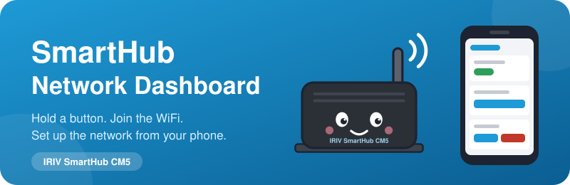
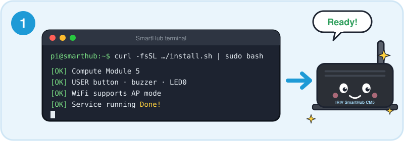
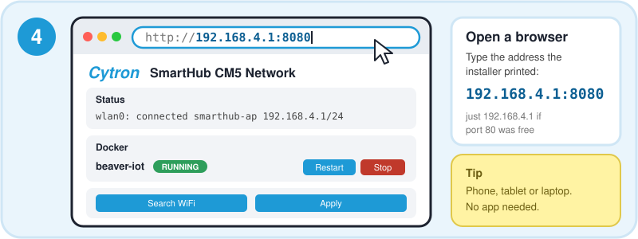
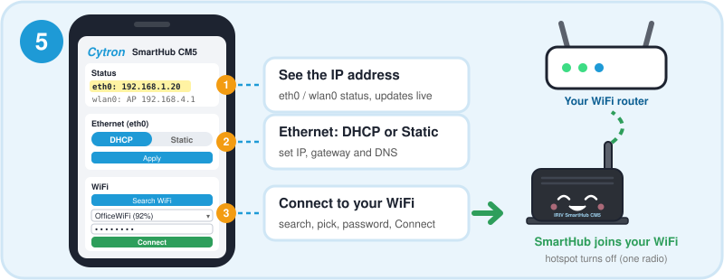

<p align="center">
  
</p>

<p align="center">
  <a href="https://github.com/dineshpalsingh1989/smarthub-cm5-dashboard/releases/latest"></a>
  
  
  <a href="LICENSE"></a>
</p>

> 🧪 **This is the `beta` branch (V2.0-beta): for testing, not for production.** It adds USB port status, a hardware check, OS and software info, and frees the dashboard port while the hotspot is off. Stable version: [`main`](https://github.com/dineshpalsingh1989/smarthub-cm5-dashboard/tree/main).
>
> Install the beta (same checks as the stable installer; installing `main` again switches back):
> ```bash
> curl -fsSL https://raw.githubusercontent.com/dineshpalsingh1989/smarthub-cm5-dashboard/beta/install.sh | sudo bash
> ```

Set up your **IRIV SmartHub CM5** network with just a phone. Hold one button and the SmartHub makes its own WiFi hotspot. Open a web page and choose Ethernet or WiFi settings. No keyboard, screen or app needed.

**You need:** an IRIV SmartHub CM5 running Raspberry Pi OS Bookworm or newer, and a phone or laptop with WiFi.

### 🪶 Very light: safe to leave running

It runs in the background all the time, so it is built to use almost nothing. Measured on an IRIV SmartHub CM5 (4 cores) over 60 seconds:

| | CPU | RAM |
|---|---|---|
| Idle, hotspot **off** | **~0.03 %** of one core (17 ms per minute) | ~27 MB |
| Idle, hotspot **on** (LED0 flashing) | **~0.04 %** of one core (23 ms per minute) | ~27 MB |
| Dashboard open in a browser | Small, short bursts every 10 s while the page is open | ~27 MB |

**Why it is so light:**
- The USER button uses kernel GPIO events, so it sleeps until the button is actually pressed. Nothing keeps checking the pin.
- The LED0 check reads wlan0's address directly and starts no other program.
- The web page does no work until someone opens it. It uses only Python's standard library, so there is no extra framework.

Check it yourself:

```bash
ps -o %cpu,rss,etime -p $(systemctl show smarthub-ap -p MainPID --value)   # CPU %, RAM in KB, uptime
```

---

## Step 1 · Install

<p align="center"></p>

Open a terminal on the SmartHub (keyboard + screen, or SSH) and paste **one** line:

```bash
curl -fsSL https://raw.githubusercontent.com/dineshpalsingh1989/smarthub-cm5-dashboard/main/install.sh | sudo bash
```

The installer **checks your SmartHub before changing anything**. Each check prints `[OK]`:

| Check | What it means |
|---|---|
| Compute Module 5 | Right compute module |
| SmartHub onboard USB hub (`1a86:8091`) | It is an IRIV SmartHub CM5 carrier board, not another CM5 board |
| NetworkManager, gpiozero, libgpiod | Right OS (Raspberry Pi OS Bookworm or newer) |
| USER button (GPIO4) | Button wired and not pressed |
| Buzzer (GPIO19) + LED0 (GPIO20) | **You hear a beep and see LED0 blink** |
| WiFi supports AP mode | The hotspot can start |
| Docker *(optional)* | If Docker is missing, it still installs. The dashboard's Docker section says *"Docker is not installed"* |

**If a check fails**, the installer asks before going further:

```
  [FAIL] SmartHub USB hub not found - not an IRIV SmartHub CM5? ...
         Skip this check and install anyway? [y/N]
```

- Press **Enter** (or `n`) to stop. Nothing is changed.
- Press **`y`** to skip it and install anyway. The buzzer/LED test is then skipped too, and at the end it warns that some features may not work.
- To skip failed checks without being asked, for example in a script:
  ```bash
  curl -fsSL https://raw.githubusercontent.com/dineshpalsingh1989/smarthub-cm5-dashboard/main/install.sh | sudo bash -s -- --force
  ```
- Missing **software** (NetworkManager, gpiozero, libgpiod) can't be skipped, because the dashboard can't run without it. The installer tells you the `apt install` command to fix it. At the end it prints the address to open, for example `http://192.168.4.1:8080`. **Write it down.**

<details>
<summary><b>No internet on the SmartHub? Install from the download package</b></summary>

1. On your PC, download **`smarthub-cm5-dashboard.zip`** from [Releases](https://github.com/dineshpalsingh1989/smarthub-cm5-dashboard/releases/latest).
2. Copy it to the SmartHub with a USB stick, or with:
   ```bash
   scp smarthub-cm5-dashboard.zip pi@<smarthub-ip>:~
   ```
3. On the SmartHub:
   ```bash
   unzip smarthub-cm5-dashboard.zip
   sudo bash smarthub-cm5-dashboard/install.sh
   ```
</details>

---

## Step 2 · Hold the USER button for 5 seconds

<p align="center"></p>

The **USER** button is on the right side, next to the USB 3.0 ports. Keep holding until you hear **one long beep**. **LED0 starts flashing** while the hotspot is on.

---

## Step 3 · Join the SmartHub WiFi

<p align="center"></p>

On your phone or laptop, open the WiFi settings and join:

| WiFi name | Password |
|---|---|
| **`smarthub`** | **`smarthub1`** |

> Your phone may say *"No internet"*. That is normal: tap **Stay connected**.

---

## Step 4 · Open the dashboard

<p align="center"></p>

Open any browser and type the address the installer printed:

- **`http://192.168.4.1:8080`** if another app (such as Beaver-IoT) already uses port 80
- **`http://192.168.4.1`** otherwise

> 🔒 **The dashboard only opens through the SmartHub hotspot.** When the hotspot is off, or you are on your normal office/factory network, the page is blocked: it shows *"Connect to the SmartHub AP"*. This is on purpose. The dashboard has no login and can change network settings and stop Docker containers, so a person must be at the device and hold the USER button to use it.
>
> | Opened from | Works? |
> |---|---|
> | Phone/laptop joined to the `smarthub` WiFi | ✅ |
> | The SmartHub itself, or through an SSH tunnel (see below) | ✅ |
> | Any other device on your normal network | ❌ blocked |
>
> <details>
> <summary>Need it while the hotspot is off? Use an SSH tunnel</summary>
>
> From your PC (anyone using this needs the SmartHub's SSH password):
>
> ```bash
> ssh -L 8080:127.0.0.1:8080 pi@<smarthub-ip>
> ```
>
> Keep that window open, then browse to **http://localhost:8080** on your PC. If the installer said port 80, use `-L 8080:127.0.0.1:80` instead.
> </details>

---

## Step 5 · Set up your network

<p align="center"></p>

The dashboard is mainly for **seeing and setting up the SmartHub's network** without a keyboard or screen:

1. **See the IP address.** **Status** shows the IP of **eth0** (Ethernet) and **wlan0** (WiFi), so you know where to find the SmartHub on your network.
2. **Set up Ethernet.** Choose **Dynamic (DHCP)**, or **Static** and enter the IP / prefix, gateway and DNS. Then press **Apply**.
3. **Connect the SmartHub to your WiFi.** Press **Search WiFi**, pick your network, enter its password, choose DHCP or Static, then press **Connect**. The SmartHub leaves the hotspot and joins your WiFi. Your phone disconnects because the board has one WiFi radio. Check the new IP in your router, or turn the hotspot on again and look at Status.

<details>
<summary><b>See a real screenshot and every section</b></summary>

<table>
<tr>
<td width="330"></td>
<td>

| Section | What you can do |
|---|---|
| **Status** | See eth0 / wlan0 state and IP address |
| **Docker** | See containers: 🟢 running, ⚪ stopped, 🔴 error. **Start**, **Stop** or **Restart** them |
| **Ethernet** | Choose **Dynamic (DHCP)** or **Static** (IP / prefix, gateway, DNS), then **Apply** |
| **WiFi** | **Search WiFi**, pick a network, enter its password, choose DHCP or Static, then **Connect** |
| **Access Point** | Change the hotspot name and password, or **Turn off AP** |

**Good to know**

- Connecting to WiFi **turns the hotspot off**, because the board has one WiFi radio, so your phone disconnects. If the connection fails, the hotspot comes back on.
- Changing Ethernet can change the SmartHub's IP address on your wired network.
- The page refreshes itself every 10 seconds.

</td>
</tr>
</table>
</details>

---

## Step 6 · Turn the hotspot off

<p align="center"></p>

When you're done, hold **USER** for 5 seconds again: you hear **two short beeps** and **LED0 turns off**. You can also press **Turn off AP** on the dashboard. The SmartHub stays on your network with the settings you made. The dashboard closes until you turn the hotspot on again.

| Sound | Meaning |
|---|---|
| 1 long beep | Hotspot on |
| 2 short beeps | Hotspot off, or WiFi connected |
| 5 fast beeps | Something failed (see Troubleshooting) |

> 🔒 **Security:** change the default password `smarthub1` in **Access Point** for devices in the field. It is published in this README.

---

## Update

Run the same install line again, or download the newest package from [Releases](https://github.com/dineshpalsingh1989/smarthub-cm5-dashboard/releases/latest). Your settings are kept. The version is shown at the bottom of the dashboard.

## Troubleshooting

| Problem | Try |
|---|---|
| No beep when holding USER | `sudo systemctl status smarthub-ap`. Is it *active (running)*? |
| 5 fast beeps | `sudo journalctl -u smarthub-ap -n 30` shows the error |
| Can't see `smarthub` WiFi | Wait 10 s after the beep. Check LED0 is flashing |
| Page doesn't open | Use the exact address from the installer, with `:8080` if it printed that |
| Wrong page opens (e.g. Beaver-IoT) | Add `:8080` to the address |
| Page says *"Connect to the SmartHub AP"* | You are not on the `smarthub` WiFi. Turn the hotspot on (hold USER 5 s) and join it, or use an SSH tunnel |

Live log: `sudo journalctl -u smarthub-ap -f`

## Uninstall

```bash
sudo systemctl disable --now smarthub-ap
sudo rm -rf /opt/smarthub /etc/systemd/system/smarthub-ap.service
```

## License

[MIT](LICENSE) © 2026 Dineshpal Singh. Free to use, change and share. Keep the copyright notice. No warranty.

---

<p align="center"><sub>Built for the IRIV SmartHub CM5 (Cytron Technologies)</sub></p>
