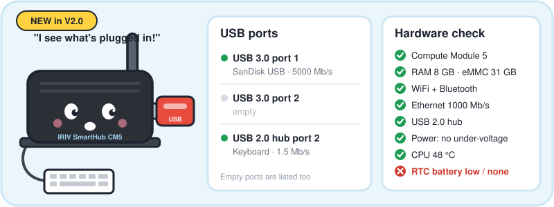
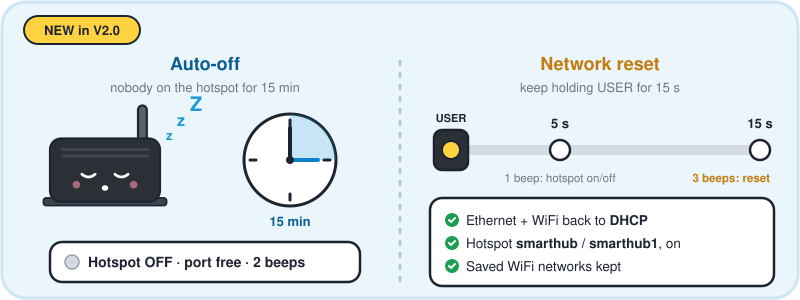
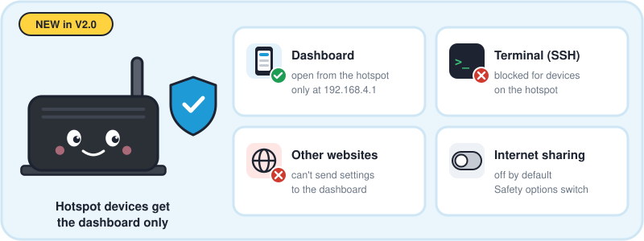
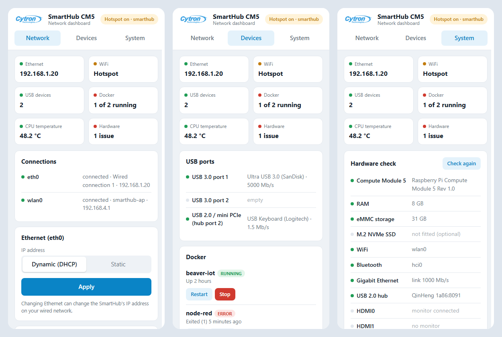
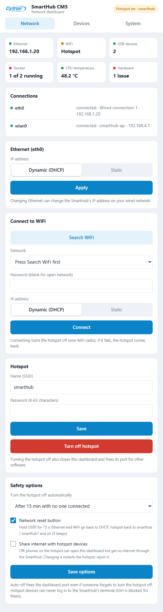

<p align="center">
  
</p>

<p align="center">
  <a href="https://github.com/dineshpalsingh1989/smarthub-cm5-dashboard/releases/latest"></a>
  <a href="https://github.com/dineshpalsingh1989/smarthub-cm5-dashboard/actions/workflows/test.yml?query=branch%3Abeta"></a>
  
  
  <a href="LICENSE"></a>
</p>

<p align="center">
  <a href="https://github.com/dineshpalsingh1989/smarthub-cm5-dashboard/releases/tag/v2.0-beta"></a>
</p>

> 🧪 **This is the `beta` branch: V2.0 beta, for testing and not yet for production.** The stable version is [V1.4.1 on `main`](https://github.com/dineshpalsingh1989/smarthub-cm5-dashboard/tree/main).
>
> Install the beta. The installer runs the same checks as the stable one, and running the `main` install line again switches back:
> ```bash
> curl -fsSL https://raw.githubusercontent.com/dineshpalsingh1989/smarthub-cm5-dashboard/beta/install.sh | sudo bash
> ```
> Or download `smarthub-cm5-dashboard-v2.0-beta.zip` from the [V2.0 beta release](https://github.com/dineshpalsingh1989/smarthub-cm5-dashboard/releases/tag/v2.0-beta).

## 🆕 What's new in V2.0

**V2.0 at a glance**

| | Feature | Where |
|---|---|---|
| 🧭 | New dashboard: overview tiles, Network / Devices / System tabs, dark mode | Whole page |
| 🔌 | USB ports and what's plugged in | Devices tab |
| 🩺 | Hardware check from the SmartHub datasheet | System tab |
| 🧾 | OS version, kernel, uptime, installed software | System tab |
| 🚪 | Port closed and freed while the hotspot is off | Automatic |
| ⏲️ | Hotspot turns itself off when nobody is connected (15 min) | Safety options |
| 🛟 | Network reset: hold USER 15 s | USER button |
| 🌐 | Internet sharing for hotspot devices, off by default | Safety options |
| 🔒 | No terminal (SSH) for hotspot devices, other websites blocked | Automatic |
| ✅ | Automatic tests on every GitHub update | GitHub Actions |

### 1 · A new dashboard: overview tiles and three tabs

<p align="center"></p>

- **Overview tiles** at the top show Ethernet IP, WiFi, USB devices, Docker, CPU temperature and hardware issues. A green, amber or red dot on each makes problems easy to spot.
- **Three tabs** mean less scrolling on a phone:
  - **Network:** connections, Ethernet, WiFi and hotspot
  - **Devices:** USB ports and Docker
  - **System:** hardware check, OS and software
- A **DHCP / Static switch** replaces the dropdown. Messages pop up at the bottom, and dark mode follows your phone's setting.

### 2 · USB ports, hardware check, OS and software

<p align="center"></p>

| Section | What it shows |
|---|---|
| **USB ports** | Each port and what's plugged in (name, maker, speed), for example `USB 3.0 port 1: SanDisk · 5000 Mb/s`. Empty ports say **empty**. The black USB 2.0 ports and the mini PCIe slot are listed by their position on the onboard USB hub. |
| **Hardware check** (from the SmartHub datasheet) | CM5 model, RAM, eMMC, M.2 NVMe (optional), WiFi, Bluetooth, Ethernet link speed, USB 2.0 hub, HDMI0/1 monitor, RTC + CR2032 battery, CPU temperature, power under-voltage, and the button/LED/buzzer pins. Press **Check again** to refresh. |
| **System** | OS version, kernel, OS image date, hostname, uptime, number of packages installed |
| **Software** | Versions of Python, Docker, Docker Compose, NetworkManager, Node.js, Node-RED, Mosquitto, Nginx and Git, or *not installed* |

### 3 · The port is freed when the hotspot is off

<p align="center"></p>

- The dashboard's web server **only runs while the hotspot is on**, and only on the hotspot address (`192.168.4.1`).
- When you turn the hotspot off, the server **stops and the port closes**, so other software can use it.
- The USER button keeps listening in the background with ~0% CPU, ready to turn the hotspot on again.

### 4 · Safety options: auto-off and network reset

<p align="center"></p>

Find them in the **Network** tab, card **Safety options**. They are saved on the SmartHub and kept when you update.

| Option | Default | What it does |
|---|---|---|
| **Turn the hotspot off automatically** | After 15 min with no one connected | When no phone or laptop has been on the hotspot for that long, the SmartHub turns it off by itself (2 short beeps, LED0 off) and the dashboard port is freed. Choose 5, 10, 15, 30 or 60 min, or *Never*. |
| **Network reset button** | On | Keep holding **USER for 15 seconds** (past the 5 s beep) to rescue a SmartHub you can't reach: Ethernet and WiFi go back to **DHCP**, and the hotspot goes back to **`smarthub` / `smarthub1`** and turns on. You hear **3 beeps**. Saved WiFi networks are kept. Untick it if nobody should be able to reset the network from the button. |
| **Share internet with hotspot devices** | Off | Off: phones on the hotspot can open the dashboard but get no internet through the SmartHub. Turn it on only if hotspot devices need internet. Changing it restarts the hotspot, so rejoin it. |

How the button works now:

| Hold USER | You hear | What happens |
|---|---|---|
| 5 s, then let go | 1 long beep / 2 short beeps | Hotspot on / off (same as before) |
| 15 s | the 5 s beep, then **3 beeps** | Network reset (if switched on) |

### 5 · Locked down for safety

<p align="center"></p>

- **No terminal for hotspot devices.** The installer blocks SSH logins from the hotspot (`192.168.4.x`). Hotspot devices can only use the dashboard. SSH from your normal network keeps working.
- **Other websites can't use the dashboard.** A web page open on the phone, even one loaded over mobile data, can't send settings to the SmartHub. The dashboard only accepts its own page (checks the address, `Origin` and JSON-only requests).
- **No stuck connections.** Requests are limited to 4 KB, and a device that goes silent for 10 seconds is disconnected.
- **Safer network changes.** A new Ethernet/WiFi profile is saved before the old one is removed, so if NetworkManager rejects it, your old settings stay.
- The dashboard has no terminal or command box. Docker buttons only start, stop or restart existing containers. The only thing it can install is Beaver IoT (the official `milesight/beaver-iot` image).

### 6 · Still very light

- The whole page is **about 14 KB**: no frameworks, no web fonts, nothing loaded from the internet.
- The page **stops refreshing while the browser tab is in the background,** so a forgotten phone doesn't keep the SmartHub busy.
- With the hotspot off, only the same tiny button watcher runs as in V1.2+ (measured at about 0.03% of one core).
- The new safety features add almost nothing: the "is anyone connected?" check runs every 30 s, and only while the hotspot is on.

### 7 · Internet check and Beaver IoT install

- An **Internet** tile shows whether the SmartHub can reach the internet, and through which port (*yes · LAN port* when the Ethernet cable has internet). It really connects to Docker Hub, so *yes* means a download will work.
- **Devices · Beaver IoT:** if Beaver IoT is not installed, the dashboard asks *"Download and install Beaver IoT now?"*, but only when there is internet.
- **No internet? Use a USB pendrive.** On any PC with Docker and internet:
  ```
  docker pull --platform linux/arm64 milesight/beaver-iot
  docker save milesight/beaver-iot -o beaver-iot.tar
  ```
  Copy `beaver-iot.tar` to the top folder of a pendrive (exFAT or NTFS: the file can be bigger than FAT32's 4 GB limit), plug it into any SmartHub USB port and press **Install from USB pendrive**. The pendrive is mounted read-only and unmounted afterwards.
- Beaver IoT runs with `--restart unless-stopped`, data in `/var/lib/beaver-iot`, MQTT on 1883. Its web page is on port **80**, or **9080** if this dashboard already uses port 80. Open it from your LAN at the SmartHub's Ethernet IP.

### See it

<p align="center"><br><sub>Network, Devices and System tabs (sample data)</sub></p>

<details>
<summary><b>See the whole Network tab, with Safety options</b></summary>
<p align="center"></p>
</details>

### V1.4.1 vs V2.0

| | V1.4.1 (stable) | V2.0 (beta) |
|---|---|---|
| Network setup (Ethernet / WiFi / hotspot) | ✅ | ✅ |
| Docker start / stop / restart | ✅ | ✅ |
| Overview tiles + tabs + dark mode | ❌ | ✅ |
| USB ports: what's plugged in | ❌ | ✅ |
| Hardware check from the datasheet | ❌ | ✅ |
| OS + software versions | ❌ | ✅ |
| Port closed and freed while hotspot is off | ❌ (always open) | ✅ |
| Hotspot turns off by itself when nobody is connected | ❌ | ✅ |
| Network reset: hold USER 15 s | ❌ | ✅ |
| SSH blocked for hotspot devices, other websites blocked | ❌ | ✅ |
| Internet sharing for hotspot devices | Always on | Switch, off by default |
| Internet check + Beaver IoT install (internet or USB pendrive) | ❌ | ✅ |
| Open through an SSH tunnel while hotspot is off | ✅ | ❌ (port is closed) |

### Beta: still to confirm on real hardware

- **Port labels.** That "USB 3.0 port 1/2" and "hub port N" match the physical ports. Plug a device into each port, one at a time, to check.
- **RTC battery voltage and HDMI monitor status.** These depend on Raspberry Pi OS reporting them. If it doesn't, the rows show *unknown*.
- **Port open/close** when the hotspot turns on and off.
- **Internet switch and SSH block.** That phones get no internet with the switch off, and that SSH from `192.168.4.x` is refused.
- **Auto-off and the 15 s network reset.** Auto-off counts connected phones with `iw` (part of Raspberry Pi OS). If `iw` is missing, the hotspot never turns off by itself.

Please report anything odd on [GitHub Issues](https://github.com/dineshpalsingh1989/smarthub-cm5-dashboard/issues).

---

Set up your **IRIV SmartHub CM5** network with just a phone. Hold one button and the SmartHub makes its own WiFi hotspot. Open a web page and choose Ethernet or WiFi settings. No keyboard, screen or app needed.

**You need:** an IRIV SmartHub CM5 running Raspberry Pi OS Bookworm or newer, and a phone or laptop with WiFi.

### 🪶 Very light: safe to leave running

It runs in the background all the time, so it is built to use almost nothing. Measured on an IRIV SmartHub CM5 (4 cores) over 60 seconds:

| | CPU | RAM |
|---|---|---|
| Idle, hotspot **off** | **~0.03 %** of one core (17 ms per minute) | ~27 MB |
| Idle, hotspot **on** (LED0 flashing) | **~0.04 %** of one core (23 ms per minute) | ~27 MB |
| Dashboard open in a browser | Small, short bursts every 10 s while the page is open | ~27 MB |

**Why it is so light:**
- The USER button uses kernel GPIO events, so it sleeps until the button is actually pressed. Nothing keeps checking the pin.
- The LED0 check reads wlan0's address directly and starts no other program.
- The web page does no work until someone opens it. It uses only Python's standard library, so there is no extra framework.

Check it yourself:

```bash
ps -o %cpu,rss,etime -p $(systemctl show smarthub-ap -p MainPID --value)   # CPU %, RAM in KB, uptime
```

---

## Step 1 · Install

<p align="center"></p>

Open a terminal on the SmartHub (keyboard + screen, or SSH) and paste **one** line:

```bash
curl -fsSL https://raw.githubusercontent.com/dineshpalsingh1989/smarthub-cm5-dashboard/main/install.sh | sudo bash
```

The installer **checks your SmartHub before changing anything**. Each check prints `[OK]`:

| Check | What it means |
|---|---|
| Compute Module 5 | Right compute module |
| SmartHub onboard USB hub (`1a86:8091`) | It is an IRIV SmartHub CM5 carrier board, not another CM5 board |
| NetworkManager, gpiozero, libgpiod | Right OS (Raspberry Pi OS Bookworm or newer) |
| USER button (GPIO4) | Button wired and not pressed |
| Buzzer (GPIO19) + LED0 (GPIO20) | **You hear a beep and see LED0 blink** |
| WiFi supports AP mode | The hotspot can start |
| Docker *(optional)* | If Docker is missing, it still installs. The dashboard's Docker section says *"Docker is not installed"* |

**If a check fails**, the installer asks before going further:

```
  [FAIL] SmartHub USB hub not found - not an IRIV SmartHub CM5? ...
         Skip this check and install anyway? [y/N]
```

- Press **Enter** (or `n`) to stop. Nothing is changed.
- Press **`y`** to skip it and install anyway. The buzzer/LED test is then skipped too, and at the end it warns that some features may not work.
- To skip failed checks without being asked, for example in a script:
  ```bash
  curl -fsSL https://raw.githubusercontent.com/dineshpalsingh1989/smarthub-cm5-dashboard/main/install.sh | sudo bash -s -- --force
  ```
- Missing **software** (NetworkManager, gpiozero, libgpiod) can't be skipped, because the dashboard can't run without it. The installer tells you the `apt install` command to fix it. At the end it prints the address to open, for example `http://192.168.4.1:8080`. **Write it down.**

<details>
<summary><b>No internet on the SmartHub? Install from the download package</b></summary>

1. On your PC, download **`smarthub-cm5-dashboard.zip`** from [Releases](https://github.com/dineshpalsingh1989/smarthub-cm5-dashboard/releases/latest).
2. Copy it to the SmartHub with a USB stick, or with:
   ```bash
   scp smarthub-cm5-dashboard.zip pi@<smarthub-ip>:~
   ```
3. On the SmartHub:
   ```bash
   unzip smarthub-cm5-dashboard.zip
   sudo bash smarthub-cm5-dashboard/install.sh
   ```
</details>

---

## Step 2 · Hold the USER button for 5 seconds

<p align="center"></p>

The **USER** button is on the right side, next to the USB 3.0 ports. Keep holding until you hear **one long beep**, then let go. **LED0 starts flashing** while the hotspot is on.

> 🛟 **Locked out?** Keep holding **USER for 15 seconds** until you hear **3 beeps**: Ethernet and WiFi go back to DHCP, and the hotspot goes back to `smarthub` / `smarthub1`. See [Safety options](#4--safety-options-auto-off-and-network-reset).

---

## Step 3 · Join the SmartHub WiFi

<p align="center"></p>

On your phone or laptop, open the WiFi settings and join:

| WiFi name | Password |
|---|---|
| **`smarthub`** | **`smarthub1`** |

> Your phone may say *"No internet"*. That is normal: internet sharing is off by default. Tap **Stay connected**.

---

## Step 4 · Open the dashboard

<p align="center"></p>

Open any browser and type the address the installer printed:

- **`http://192.168.4.1:8080`** if another app (such as Beaver-IoT) already uses port 80
- **`http://192.168.4.1`** otherwise

> 🔒 **The dashboard only opens through the SmartHub hotspot.** In V2.0 it only runs while the hotspot is on, and only on the hotspot address `192.168.4.1`. From your normal office or factory network the page doesn't open at all, and with the hotspot off the port is closed. This is on purpose. The dashboard has no login and can change network settings and stop Docker containers, so a person must be at the device and hold the USER button to use it.
>
> | Opened from | Works? |
> |---|---|
> | Phone/laptop joined to the `smarthub` WiFi | ✅ |
> | Any other device on your normal network | ❌ |
> | Anything, while the hotspot is off | ❌ (port closed) |

---

## Step 5 · Set up your network

<p align="center"></p>

The dashboard is mainly for **seeing and setting up the SmartHub's network** without a keyboard or screen:

1. **See the IP address.** The **Ethernet** and **WiFi** tiles and the **Connections** card show the IP of **eth0** (Ethernet) and **wlan0** (WiFi), so you know where to find the SmartHub on your network.
2. **Set up Ethernet.** Choose **Dynamic (DHCP)**, or **Static** and enter the IP / prefix, gateway and DNS. Then press **Apply**.
3. **Connect the SmartHub to your WiFi.** Press **Search WiFi**, pick your network, enter its password, choose DHCP or Static, then press **Connect**. The SmartHub leaves the hotspot and joins your WiFi. Your phone disconnects because the board has one WiFi radio. Check the new IP in your router, or turn the hotspot on again and look at **Connections**.

<details>
<summary><b>See a real screenshot and every section</b></summary>

<table>
<tr>
<td width="330"></td>
<td>

| Section | What you can do |
|---|---|
| **Tiles** (top) | Ethernet IP, Internet, WiFi, USB devices, Docker, CPU temperature, hardware issues |
| **Network · Connections** | eth0 / wlan0 state and IP address |
| **Network · Ethernet** | Choose **Dynamic (DHCP)** or **Static** (IP / prefix, gateway, DNS), then **Apply** |
| **Network · Connect to WiFi** | **Search WiFi**, pick a network, enter its password, choose DHCP or Static, then **Connect** |
| **Network · Hotspot** | Change the hotspot name and password, or **Turn off hotspot** |
| **Network · Safety options** | Auto-off time, network reset button, internet sharing |
| **Devices** | USB ports, and Docker containers: 🟢 running, ⚪ stopped, 🔴 error. **Start**, **Stop** or **Restart** them. **Beaver IoT:** install from the internet or a USB pendrive |
| **System** | Hardware check, OS and software versions |

**Good to know**

- Connecting to WiFi **turns the hotspot off**, because the board has one WiFi radio, so your phone disconnects. If the connection fails, the hotspot comes back on.
- Changing Ethernet can change the SmartHub's IP address on your wired network.
- The page refreshes itself every 10 seconds.

</td>
</tr>
</table>
</details>

---

## Step 6 · Turn the hotspot off

<p align="center"></p>

When you're done, hold **USER** for 5 seconds again: you hear **two short beeps** and **LED0 turns off**. You can also press **Turn off hotspot** on the dashboard. If you forget, it turns itself off after 15 minutes with nobody connected. The SmartHub stays on your network with the settings you made. The dashboard closes and its port is freed until you turn the hotspot on again.

| Sound | Meaning |
|---|---|
| 1 long beep | Hotspot on |
| 2 short beeps | Hotspot off (button, dashboard or auto-off), or WiFi connected |
| 3 beeps (holding USER 15 s) | Network reset: DHCP + default hotspot |
| 5 fast beeps | Something failed (see Troubleshooting) |

> 🔒 **Security:** change the default password `smarthub1` in the **Hotspot** card for devices in the field. It is published in this README.

---

## Update

Run the same install line again, or download the newest package from [Releases](https://github.com/dineshpalsingh1989/smarthub-cm5-dashboard/releases/latest). Your settings are kept. The version is shown at the bottom of the dashboard.

## Troubleshooting

| Problem | Try |
|---|---|
| No beep when holding USER | `sudo systemctl status smarthub-ap`. Is it *active (running)*? |
| 5 fast beeps | `sudo journalctl -u smarthub-ap -n 30` shows the error |
| Can't see `smarthub` WiFi | Wait 10 s after the beep. Check LED0 is flashing |
| Page doesn't open | Use the exact address from the installer, with `:8080` if it printed that |
| Wrong page opens (e.g. Beaver-IoT) | Add `:8080` to the address |
| Page still doesn't open | You are not on the `smarthub` WiFi, or the hotspot is off. Hold USER 5 s, wait for the beep, join `smarthub`, then open the address again |
| Hotspot turned off by itself | Auto-off: nobody was connected for 15 min. Hold USER 5 s to turn it on again, or change it in **Safety options** |
| Forgot the hotspot password, or a wrong static IP | Hold USER for **15 s** until you hear 3 beeps: network back to DHCP, hotspot back to `smarthub` / `smarthub1` |

Live log: `sudo journalctl -u smarthub-ap -f`

## Uninstall

```bash
sudo systemctl disable --now smarthub-ap
sudo rm -rf /opt/smarthub /etc/systemd/system/smarthub-ap.service \
  /etc/ssh/sshd_config.d/smarthub-ap.conf /etc/NetworkManager/dnsmasq-shared.d/smarthub-no-internet.conf
sudo systemctl reload ssh
```

## License

[MIT](LICENSE) © 2026 Dineshpal Singh. Free to use, change and share. Keep the copyright notice. No warranty.

---

<p align="center"><sub>Built for the IRIV SmartHub CM5 (Cytron Technologies)</sub></p>
